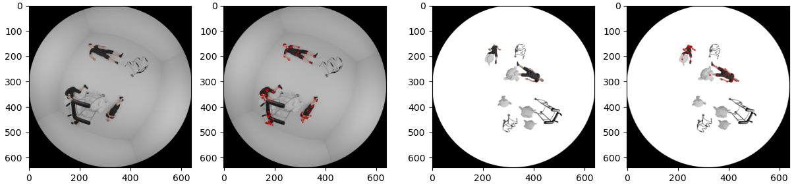

# Blender-based Synthetic Data Generator for Fisheye Pose Estimation



A fully modular pipeline for generating **synthetic human pose datasets** using **Blender**, tailored for **fisheye camera** applications.  
This system programmatically spawns, randomizes, poses, and renders 3D rigged characters and exports their **2D fisheye-projected keypoints** for training pose-estimation models (e.g., YOLO-Pose).

***The code may seem promiscuous, but I can't help it because it has to be in one file to run python code in blender.***

---

## ✨ Features

### 🎥 Fisheye Camera Model
- Implements an **equidistant fisheye projection**.
- Converts world-space keypoints → 2D UV coordinates (normalized 0–1).

### 🧱 Modular Spawner System
Spawner classes automate the entire pipeline:
- Object spawning/despawning
- Location/scale/rotation randomization
- Pose loading & application
- Keypoint extraction

Spawner types:
- `BaseSpawner`
- `RiggedObjectSpawner`
- `KeypointRiggedObjectSpawner` (main spawner)
- `RandomObjectSpawner` (random prop selection)
- `StickingKeypointRiggedObjectSpawner` (attach props to characters)

### 🦴 Rig & Pose Support
- Supports any armature-based character.
- Loads `.pkl` pose files from categorized folders.

### 🔑 2D Keypoint Export
- Output saved as `.pkl`
- Python list of NumPy arrays: each array = a person’s `(N, 2)` keypoints  
- Coordinates normalized to **(y, x) in [0, 1]**

### 🌎 Diverse Randomization
Configure:
- Count per scene
- Spatial ranges
- Scale ranges
- Rotation ranges
- Pose categories
- Probabilistic multi-object interactions

---

## 📂 Example Output

Each iteration produces:
````
test0.png      # Rendered fisheye image
test0.pkl      # List of persons’ 2D keypoints
````

**Keypoint file structure:**

```python
[
    np.array([[y, x], ..., [y, x]]),  # person 1 (15x2)
    np.array([...]),                  # person 2
    ...
]
````

If no characters spawned → list is empty.

---

## 🛠️ Setup & Installation

### 1. Install Blender

I recommand using **Blender 4.5.4**.

Download: <href>https://www.blender.org/download/release/Blender4.5/blender-4.5.4-windows-x64.msi/</href>

### 2. Install Python Dependencies (inside Blender Python)

Locate Blender's Python:

* **Windows**
  `C:\Program Files\Blender Foundation\Blender 4.5\4.5\python\bin\python.exe`

* **macOS**
  `/Applications/Blender.app/Contents/Resources/4.5/python/bin/python4.5`

* **Linux**
  `~/blender-4.5/4.5/python/bin/python4.5`

Install NumPy:

```bash
"<PATH-TO-THE-BLENDER-PYTHON>" -m pip install numpy
```

---

## 📦 Demo Project Structure

If you open `demo-scene.blend` file, you would see:

* `base_monkey` (static mesh)
* `base_patient` (rigged human)
* `base_walkers` (Single Bone with multiple mesh rigged)
* A Camera object (fisheye parameters handled in script)

A directory of `.pkl` pose files is located in ```./animations/pose/```

---

## 🚀 How to Run

1. Open your Blender demo scene file `demo-scene.blend`.
2. Go to **Scripting** workspace.
3. Load the Python generator script ```./scripts/yolo_blender_v_1_0.py```.
4. Update paths:

```python
if __name__ == "__main__":
    # Note that the directories have to be Absolute Path
    out_dir = 'C:/<CLONED-PATH-OF-THIS-REPO>/out/'
    pose_dir = 'C:/<CLONED-PATH-OF-THIS-REPO>/animations/pose/'
    ...
```

5. Press **Run Script** (▶).
6. Blender will generate images & annotations in your `out_dir`.

---

## 🧬 Spawner System Overview

### `BaseSpawner`

* Generic object spawner
* Random location/scale/rotation
* Handles activation/deactivation lifecycle

### `RiggedObjectSpawner`

* Extends `BaseSpawner`
* Applies `.pkl` pose files to an armature
* Ensures characters sit on ground plane

### `KeypointRiggedObjectSpawner`

* Extends `RiggedObjectSpawner`
* Computes world positions of rig bones
* Projects keypoints using fisheye equation
* Contains editable `kpt_mapping`

### `RandomObjectSpawner`

* For an Single Bone containing multiple meshes
* Randomly selects which child mesh to display

### `StickingKeypointRiggedObjectSpawner`

* Spawns objects at locations of another spawner’s objects
* Useful for props like walking aids

---

## 🔧 Customization

### In Advance
If you want to use your own rigged person model, you must (re-)rig your model from Mixamo. Pose files in this projects only compatible with Mixamo naming system.

### Add New Objects

In Blender:

1. Add an object or rig.
2. Name it `base_myobject`.

In Python:

```python
obj = bpy.data.objects.get('base_myobject')
```

### Configure the Randomization Range of Your Model
You can customize randomization min-Max range of your model with four aspects:
1. Location
2. Scale
3. Rotation
4. Number
```python
my_config = {
    # Location Range
    'rangeLocX': (-2.5, 2.5),
    'rangeLocY': (-3.0, 3.0),
    'rangeLocZ': (0.0, 0.0),
    
    # Scale Range
    'rangeScale': (0.7, 1.2),
    
    # Rotation Range
    'rangeRotX': (0.0, 0.0),
    'rangeRotY': (0.0, 0.0),
    'rangeRotZ': (0.0, 360.0),
    
    # Number Range
    'rangeNum': (0, 7),
}
```

### Generate Your Spawner Instance
Generate your spawner instance according to your obejctive.
```python
# Case of Non-Rigged Object:
spawner = BaseSpawner(obj, my_config)

# Case of Rigged Object:
spawner = KeypointRiggedObjectSpawner(obj, my_config, pose_dir)

# Case of Set of Objects to be Chosen
spawner = RandomObjectSpawner(obj, my_config)
```

### Spawn and Despawn your Objects
```python
# Spawning Fixed Number of Objects
spawner.spawn_objs(NUMBER-OF-OBJECTS-TO-SPAWN)

# Spawning Random Number of Objects
spawner.spawn_objs(np.random.randint(*my_config['rangeNum']))

...

# [IMPORTANT] Despawn and Re-Initialize your objects
spawner.despawn_objs()
```
---

## 📄 License

Licensed under the **MIT License**.

```
MIT License

Copyright (c) 2025 Jehyeon Park

Permission is hereby granted, free of charge, to any person obtaining a copy
of this software and associated documentation files (the "Software"), to deal
in the Software without restriction, including without limitation the rights
to use, copy, modify, merge, publish, distribute, sublicense, and/or sell
copies of the Software, and to permit persons to whom the Software is
furnished to do so, subject to the following conditions:

The above copyright notice and this permission notice shall be included in all
copies or substantial portions of the Software.

THE SOFTWARE IS PROVIDED "AS IS", WITHOUT WARRANTY OF ANY KIND, EXPRESS OR
IMPLIED, INCLUDING BUT NOT LIMITED TO THE WARRANTIES OF MERCHANTABILITY,
FITNESS FOR A PARTICULAR PURPOSE AND NONINFRINGEMENT. IN NO EVENT SHALL THE
AUTHORS OR COPYRIGHT HOLDERS BE LIABLE FOR ANY CLAIM, DAMAGES OR OTHER
LIABILITY, WHETHER IN AN ACTION OF CONTRACT, TORT OR OTHERWISE, ARISING FROM,
OUT OF OR IN CONNECTION WITH THE SOFTWARE OR THE USE OR OTHER DEALINGS IN THE
SOFTWARE.
```
